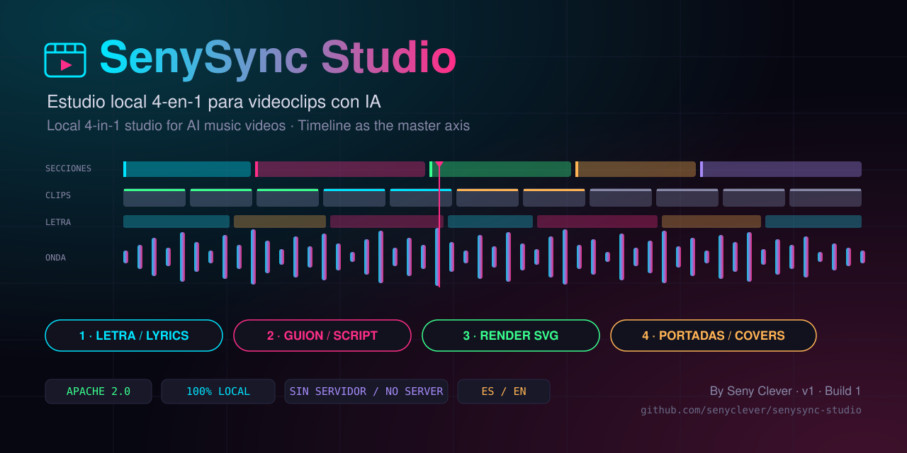
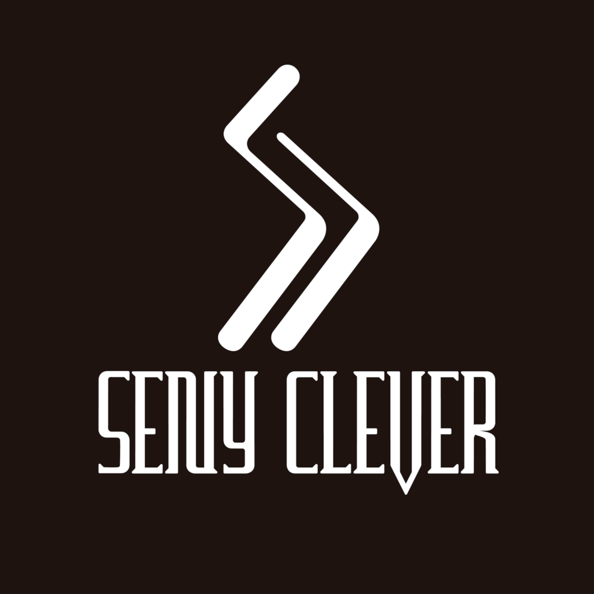

<div align="center">



# 🎬 SenySync Studio

**Estudio local 4-en-1 para videoclips con IA · Local 4-in-1 studio for AI music videos**

[](LICENSE)
[](CHANGELOG.md)
[](#-self-test)
[](#)
[](#)

[**🚀 Abrir la app / Launch app**](https://senyclever.github.io/senysync-studio/app.html) ·
[**🌐 Página / Website**](https://senyclever.github.io/senysync-studio/) ·
[**💝 Donar / Donate**](DONATIONS.md) ·
[**🐛 Issues**](https://github.com/senyclever/senysync-studio/issues)

**Español** · [English](#english)

</div>

---

## Español

### ¿Qué es?

Un estudio completo para hacer videoclips con IA que cabe en **un solo archivo HTML**. Sin servidores, sin cuentas, sin subidas, sin librerías externas, sin CDNs. Abres el archivo y trabajas. Todo ocurre en tu navegador y nada sale de tu máquina.

El **Timeline es el eje maestro**: la letra, las escenas, los clips, el motivo, los planos y las referencias se montan sobre él, y de ahí salen los prompts, los subtítulos y el render.

### Las cuatro herramientas

| | Herramienta | Qué hace |
|---|---|---|
| ✍️ | **Letra sincronizada** | Verso a verso con tiempos exactos, energía E0-E3 e intérprete. Plantilla, pegar, SRT sin música o marcado con `L`. |
| 🎬 | **Guion cinematográfico** | Partición con techo D, escenas, estéticas, motivo M0-M11, taxonomía de planos en 6 categorías y referencias de personaje. |
| 📹 | **Render SVG animado** | La IA entrega arte estático por capas; el motor aplica parallax, pulso al reloj, partículas y glow. MP4 offline, WebM con audio, PNG por lotes. |
| 🖼 | **Portadas SVG** | Key art de cine, no una captura. Re-escenificado por aspecto y título editable superpuesto por la app. |

### Características

- **Reloj dual** BPM o CSV de Sonic Visualiser, con rejilla irregular, span automático, offset propio y jerarquía configurable. El vídeo importado también puede ser el reloj maestro.
- **Timeline profesional**: bandas dinámicas, zoom suavizado, pinch, pulsación larga, doble tap, vibración al snap, seguir aguja, snap cíclico, candado D, loop de 6 estados anclado al compás y guías visuales en ambos bordes al mover una barra.
- **Contratos para IA** en dos modos: LEAN (mínimo, más atención al dibujo) y RICH (canon completo y taxonomía). Un solo compilador produce guion, render, portada y esqueletos: nunca divergen.
- **Blindaje nivel 2**: auditoría mecánica de solo lectura y no bloqueante. Verifica capas, tags, texto, scripts, viewBox, halos, suelo duro, desenfoque y número de filtros. Avisa, jamás rechaza ni modifica.
- **Texto v2**: una única función de layout alimenta canvas y SVG. Paridad exacta entre preview, PNG y SVG. 5 presets, 9 anclas, contorno, sombra doble y caja pill.
- **Estudio de exportación**: MP4 H.264 offline con WebCodecs y multiplexor propio, WebM en tiempo real con audio, secuencia PNG en ZIP por lotes.
- **Ayuda que enseña**: buscador transversal (`/` o `Ctrl+K`), glosario de 26 términos, 9 recetas paso a paso, ruta guiada de 8 pasos y avisos con botón que salta al control exacto.
- **Registros locales opcionales**: uso y lote, apagados por defecto, en claves separadas del proyecto, exportables y purgables. Nunca contienen tu obra.
- **Bilingüe** español e inglés en interfaz, ayudas, contratos y manual.
- **Accesible**: diálogos con rol y etiqueta, trampa de foco, Enter que respeta los botones y objetivos táctiles cómodos en teléfono.

### Empezar

**Opción A — en el navegador:** abre [la app](https://senyclever.github.io/senysync-studio/app.html).

**Opción B — en local:** descarga [`app.html`](app.html) y ábrelo con doble clic. No necesita instalación ni conexión.

```
1. Config      → carga audio o vídeo, define reloj, duración, FPS y resolución
2. Secciones   → arquitectura de la canción
3. Letra       → versos con sus tiempos
4. Creativo    → biblia del director y Prompt Universal
5. Exportar    → Guion para IA (autorizar o rellenar) → pega la respuesta
6. Render      → JSON para IA → importa las escenas SVG → revisa centinelas
7. Estudio     → MP4, WebM o PNG
```

> **Guarda siempre tu Proyecto `.json`** al terminar cada sesión. Es el respaldo total.

### Self-Test

La app incluye un banco de **153 pruebas** internas: reloj, partición, reindexado atómico, contratos, paridad de esqueletos, layout de texto, multiplexor MP4, blindaje, ledgers, accesibilidad y maquetación móvil.

`📤 Exportar → 🧪 Self-Test`

### Estructura del repositorio

```
index.html   página de presentación bilingüe
app.html     la aplicación completa (un solo archivo)
404.html     página de error con estilo propio
assets/      portada, favicon, logo e imagen social
.github/     plantillas de issues y pull requests
```

### Filosofía

- El Timeline es la fuente de verdad del tiempo.
- Capa musical inmutable frente a capa narrativa reautorizable.
- **Soberanía de estilo**: el estilo lo definen tu Prompt Universal y tus estéticas. `photoreal`, `no cartoon` y `painterly` son decisiones tuyas, no conflictos.
- La IA nunca dibuja texto, animación, partículas, glow ni desenfoque. Solo reserva `safeArea`.
- El motor es dueño de la animación.
- Nada de analítica externa. Todo local, privado, exportable y borrable.

### Licencia

Copyright © 2026 **Seny Clever (Carlos Carrillo)**. Licenciado bajo [Apache License 2.0](LICENSE).

Puedes usar, modificar y redistribuir este software, **incluso comercialmente**, sin pagar nada. Solo debes conservar el aviso de copyright y el archivo `NOTICE`.

### Donaciones

Si te resulta útil, una donación voluntaria sostiene el desarrollo. **No es obligatoria y no desbloquea funciones.** Ver [DONATIONS.md](DONATIONS.md) · [Colaboradores](SUPPORTERS.md) · [Registrar mi apoyo](https://github.com/senyclever/senysync-studio/issues/new?template=supporter.yml).

---

<a name="english"></a>

## English

### What is it?

A complete studio for making AI music videos that fits in **a single HTML file**. No servers, no accounts, no uploads, no external libraries, no CDNs. Open the file and work. Everything happens in your browser and nothing leaves your machine.

The **Timeline is the master axis**: lyrics, scenes, clips, motif, shots and references mount on it, and prompts, subtitles and render come out of it.

### The four tools

| | Tool | What it does |
|---|---|---|
| ✍️ | **Synced lyrics** | Verse by verse with exact times, E0-E3 energy and interpreter. Template, paste, SRT without music, or marking with `L`. |
| 🎬 | **Cinematic script** | Partition with ceiling D, scenes, aesthetics, motif M0-M11, 6-category shot taxonomy and character references. |
| 📹 | **Animated SVG render** | The AI delivers static layered art; the engine applies parallax, clock pulse, particles and glow. Offline MP4, WebM with audio, batched PNG. |
| 🖼 | **SVG covers** | Theatrical key art, not a screenshot. Re-staged per aspect with an editable title overlaid by the app. |

### Features

- **Dual clock**: BPM or Sonic Visualiser CSV with irregular grid, auto span, own offset and configurable priority. Imported video can also be the master clock.
- **Professional timeline**: dynamic bands, smooth zoom, pinch, long press, double tap, snap vibration, follow playhead, cycled snap, lock D, a 6-state bar-anchored loop and visual guides on both edges when moving a bar.
- **AI contracts** in two modes: LEAN (minimal, more attention on drawing) and RICH (full canon and taxonomy). One compiler produces script, render, cover and skeletons: they never diverge.
- **Armor level 2**: read-only, non-blocking mechanical audit. Checks layers, tags, text, scripts, viewBox, halos, hard ground, blur and filter count. It warns, never rejects or modifies.
- **Text v2**: one layout function feeds canvas and SVG. Exact parity across preview, PNG and SVG. 5 presets, 9 anchors, outline, double shadow and pill box.
- **Export studio**: offline H.264 MP4 with WebCodecs and a native muxer, realtime WebM with audio, PNG sequence in ZIP batches.
- **Help that teaches**: cross-search (`/` or `Ctrl+K`), 26-term glossary, 9 step-by-step recipes, an 8-step guided route and warnings with a button that jumps to the exact control.
- **Optional local ledgers**: usage and batch, off by default, under keys separate from the project, exportable and purgeable. They never contain your work.
- **Bilingual** Spanish and English across UI, help, contracts and manual.
- **Accessible**: dialogs with role and label, focus trap, Enter that respects buttons, and comfortable tap targets on phone.

### Getting started

**Option A — in the browser:** open [the app](https://senyclever.github.io/senysync-studio/app.html).

**Option B — locally:** download [`app.html`](app.html) and double-click it. No install, no connection needed.

```
1. Settings  → load audio or video, set clock, duration, FPS and resolution
2. Sections  → architecture of the song
3. Lyrics    → verses with their times
4. Creative  → director bible and Universal Prompt
5. Export    → AI Script (author or fill) → paste the reply
6. Render    → AI JSON → import SVG scenes → review sentinels
7. Studio    → MP4, WebM or PNG
```

> **Always save your Project `.json`** at the end of each session. It is the full backup.

### Self-Test

The app ships **153** internal tests: clock, partition, atomic reindex, contracts, skeleton parity, text layout, MP4 muxer, armor, ledgers, accessibility and mobile layout.

`📤 Export → 🧪 Self-Test`

### Repository structure

```
index.html   bilingual landing page
app.html     the complete application (single file)
404.html     styled error page
assets/      cover, favicon, logo and social image
.github/     issue and pull request templates
```

### Philosophy

- The Timeline is the source of truth for time.
- Immutable musical layer versus re-authorable narrative layer.
- **Style sovereignty**: your Universal Prompt and your aesthetics define the style. `photoreal`, `no cartoon` and `painterly` are your decisions, not conflicts.
- The AI never draws text, animation, particles, glow or blur. It only reserves `safeArea`.
- The engine owns animation.
- No external analytics. Everything local, private, exportable and erasable.

### License

Copyright © 2026 **Seny Clever (Carlos Carrillo)**. Licensed under the [Apache License 2.0](LICENSE).

You may use, modify and redistribute this software, **even commercially**, at no cost. You only need to keep the copyright notice and the `NOTICE` file.

### Donations

If it helps you, a voluntary donation sustains development. **It is not required and unlocks nothing.** See [DONATIONS.md](DONATIONS.md) · [Supporters](SUPPORTERS.md) · [Register my support](https://github.com/senyclever/senysync-studio/issues/new?template=supporter.yml).

---

<div align="center">



**SenySync Studio** · v1 · Build 1 · By Seny Clever

[Website](https://senyclever.github.io/senysync-studio/) · [App](https://senyclever.github.io/senysync-studio/app.html) · [Issues](https://github.com/senyclever/senysync-studio/issues) · [Donate](DONATIONS.md) · [Supporters](SUPPORTERS.md)

</div>
